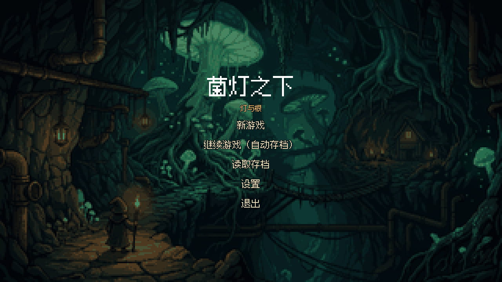
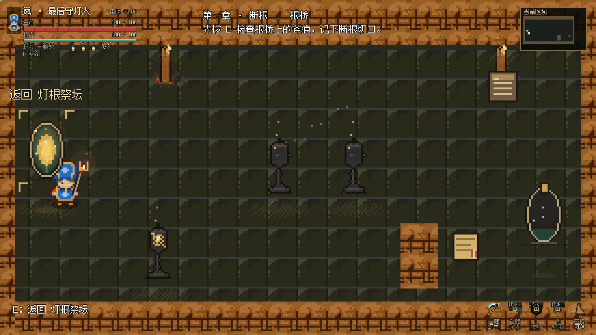

# 菌灯之下

## 游戏参赛说明与 AI 创作记录

FungusLight　｜　Windows 单机像素动作 RPG

《菌灯之下》以地下避难所的灯网危机为起点，让玩家扮演守灯人岚，使用灯杖近战与法术，在探索、战斗和调查中寻找失控的原因，最终决定人与菌群的未来。

作品已形成从新游戏、技能学习、关卡推进到 Boss 战与双结局的核心玩法闭环。参赛展示重点是以“灯”统一叙事和玩法，以及 AI 在人类需求与试玩反馈下，完成策划执行、代码实现、内容制作、验证与迭代的过程。

图 1　G6-013 标题界面实机截图。背景由图像模型生成并经像素化处理。

| 作品信息 | 当前内容 |
| --- | --- |
| 内容规模 | 5 章、37 个房间、37 组遭遇、9 个机关或调查目标 |
| 战斗与成长 | 灯杖近战、3 种法术、闪避、药剂、4 次强化选择、6 件装备 |
| 剧情收束 | 3 件关键证据、2 种结局 |
| 开发与版本 | Godot 4.3；玩法基线 G6-012；兼容性版本 G6-013 |

文档日期　2026 年 10 月 21 日

<!-- PAGE -->

## 01 游戏背景与创作思路

### 发生在同一条水脉上的冲突

地下避难所依靠菌灯照明、依靠水脉生存。人类的灯网与菌群的根系共享水源，双方曾以旧约维持共生。水源衰减后，前代守灯人兼技师禾提高泵压，并签下砍根令；菌根受损，菌群开始反击，维系生活的灯也随之失控。

玩家操控岚从营地出发，穿过矿道、菌洞、泵站与王庭。断根切口、抽水记录和旧约拓文逐步拼出事件经过。最终面对的母体，是根心在缺水中形成的新意志。理解危机的来源，决定了玩家如何看待最后的选择。

图 2　游戏开场画面，取自 G6-012 演示视频约 6 秒处。插画讲述人与菌群共用水脉的背景。

### 用灯连接玩家的行动与故事

灯杖既是武器，也是主角身份的标志；净光、护灯和灯雨围绕同一主题展开。导光装置与休息灯座让“点亮、引导、守护”进入探索过程，灯网和菌根的关系则在剧情中解释这些行动的意义。

### 让选择建立在调查之上

结局分为“恢复共生循环”和“封存并撤离”。前者意味着限流与持续维护，后者意味着带着储水离开地下旧居。证据、机关进度与撤离准备构成选择的条件，让最终决定与此前的探索相连。

<!-- PAGE -->

## 02 核心玩法与战斗体验

### 一次完整的游玩循环

进入房间并观察目标 → 扫描或交互 → 解决机关与敌人 → 获得证据、资源或强化 → 在安全点整备 → 前往新区域。玩家在重复循环中逐步获得新法术、面对更复杂的敌人组合，最终进入核心室。

### 近战与法术互相支持

灯击不消耗精力，有效命中还能回能；法术消耗精力并受冷却限制。玩家需要在贴身攻击、拉开距离、保护自己和选择施法时机之间取舍。药剂有使用过程，移动、闪避或受击会打断，因此补给也需要安全窗口。

| 行动 | 战术作用 |
| --- | --- |
| 灯击 | 近身扇形攻击；有效命中补充精力，支撑后续施法 |
| 净光 | 命中直线上的多个敌人并削减护壳；墙体会阻挡光路 |
| 护灯 | 短时吸收伤害，为危险时刻提供保护 |
| 灯雨 | 对选定区域延迟落光，需要预判敌人位置 |
| 闪避与药剂 | 利用短暂无敌避开攻击，在安全时机恢复生命 |

图 3　灯杖近战实机画面，取自 G6-012 演示视频约 42 秒处。

战斗反馈包括挥击弧光、命中数字、护盾吸收、破壳与敌方预警。六类普通敌人、两类精英和三阶段母体 Boss，分别考查走位、目标优先级、破壳与危险区域判断。

<!-- PAGE -->

## 03 探索成长与功能特色

### 环境线索进入实际操作

回声扫描可以高亮证据与交互物，玩家再通过导光装置、阀门、灯座和场景记录推进。九个机关或调查目标采用短流程交互，服务于水路、灯网和旧约的叙事。当前机关以方向切换、阀门操作和进度条件为主。

图 4　导光装置与房间探索，取自 G6-012 演示视频约 30 秒处。

### 有限选择带来不同打法

四次成长里程碑提供固定提升与二选一强化，例如提高近战或净光伤害、加强回能或护盾。六件装备分为灯镜和护符两类，各装备一件，用于调整伤害、消耗或生存能力。安全休息点允许调整配置，便于玩家尝试不同打法。

### 为完整游玩补齐支撑功能

标题菜单、暂停、目标提示、小地图、任务与证据日志形成游玩指引；自动存档、三个手动槽、坏档备份恢复和死亡后检查点恢复帮助玩家继续进度。结局前还有独立备份，方便回看关键选择。

画面以 320×180 的像素世界配合 1280×720 界面组织。低特效、减少动态、降低闪光与震屏开关照顾不同观看习惯；降低特效时仍保留危险轮廓。音频包含七个程序合成音效和一首循环 Boss 配乐。

<!-- PAGE -->

## 04 AI 创作流程与人机分工

### 从现有素材出发确定可实现的方向

项目先盘点 79 张原始素材，复核角色切片、朝向和脚底锚点，再讨论玩法。经过需求交流，方向收敛为单角色俯视动作 RPG，并取消伙伴支援。开发顺序先验证动作与命中，再扩展关卡，降低内容铺开后返工的风险。

### 分阶段实现并留下可检查的结果

1. 策划细化：将主线、角色动作、敌人、成长、机关与结局拆成可执行规格，并明确每阶段的验证条件。
2. 动作验证：实现固定步战斗、输入缓存、攻击判定和角色表现，制作可暂停、逐帧与自由试打的审核台。
3. 内容扩展：先完成可玩的序章切片，再接入完整章节、敌人、Boss、成长、装备、存档和结局。
4. 试玩迭代：根据用户对握持、剧情、交互、界面和特效的反馈定位原因，修改后重做相关验证。
5. 交付整理：导出 Windows 构建，检查发布包，保留版本提交、测试证据、交接文档与 AI 交互记录。

### 各类工具承担的工作

| 工具或参与者 | 在项目中的职责 |
| --- | --- |
| DeepSeek 系模型与 DSH 编码环境 | 需求分析、策划执行、代码与数据编写、测试修复、打包和文档 |
| 图像生成与视觉工具 | 补充标题与开场插画，辅助查看画面；历史工具说明登记为 Gemini 后端 |
| Godot 与脚本工具 | 运行游戏、导出构建；以 Python 等脚本生成像素道具、图标和音频并执行检查 |
| 人类创作者 | 确定方向、提出约束、试玩反馈、调整范围，并作出关键验收决定 |

AI 参与贯穿制作流程；游戏运行时使用已编写的逻辑与内容，不依赖在线大模型。开发跨越多个会话，模型版本未逐轮保存，因此工具说明以可追溯的工具系列与职责为准。本参赛 Word 文档由 Codex 整理生成。

<!-- PAGE -->

## 05 AI 创作亮点与具体案例

### 把观感反馈转为可验证的修改

用户曾指出灯杖没有真正握在手里，侧面还出现多余肢体。AI 据此复核原角色图，调整手部挂点、杖身长度和前后遮挡，保留原角色尺度。逐帧审核台让人类能够直接查看四向动作，再决定手感与观感是否通过。

另一轮反馈涉及传送门的外侧粒子、黑色边框与碰撞范围。传送门最终收敛为暖色椭圆、内部微光和轻微悬浮，本体碰撞缩到内部区域，粒子只绘制、不参与碰撞。这个过程同时处理了视觉表达和操作反馈。

图 5　G6-012 传送门实机截图。内部微光与收窄后的本体碰撞对应同一轮反馈修正。

### 生成内容与既有美术共同形成风格

标题和五幕开场插画由图像模型补充，随后裁切、量化并按像素规则缩放；道具和 HUD 图标由脚本绘制，音效与 Boss 配乐由程序合成。角色、敌人和场景基础使用已有 Fungus Cave 素材。不同来源经过统一处理接入游戏。

### 让 AI 的改动能够追溯

剧情审校将“缺水、抬泵压、砍根、菌群反击”整理成一致因果链，并让场景证据互相印证。工程侧则保留失败记录、修复提交与复测结果；例如重启读档曾因校验使用当前进度而被拒绝，修复后用全新进程再次读取中局存档。AI 的成果因此可以由代码、实际画面和验证记录共同检查。

<!-- PAGE -->

## 06 完成度与验证证据

### 当前已经能够体验的内容

主线五章、37 个房间与遭遇、战斗成长、机关调查、三阶段母体 Boss 和双结局均已接入游戏。G6-012 已有用户签署通过的记录；G6-013 在该玩法基础上增加双架构构建、兼容模式与启动诊断。

图 6　母体 Boss 战与净光，取自 G6-012 演示视频约 66 秒处。

### 用不同证据回答不同问题

| 核对内容 | 已保留的证据与适用范围 |
| --- | --- |
| 战斗与系统逻辑 | G6-012 的 550 项战斗断言、14 组引擎套件及跨进程存档检查均为零失败 |
| 主线可推进 | G6-012 自动默认路线 707.7 秒、跳过路线 607.4 秒，均为零死亡 |
| 主观体验 | H2 动作审核与 G6-012 用户签署；自动测试不替代人类观感判断 |
| 兼容性改进 | G6-013 已有 32 位构建启动和兼容检查；真实 32 位老电脑仍待实机验收 |

项目按约 20 分钟的体验目标收敛。自动路线使用引擎输入回放，其耗时不等于真人阅读、探索与战斗时长；G6-013 未重跑完整路线，沿用 G6-012 的路线基线。

### 当前边界与后续方向

完整按键重设和地区背景音乐尚未实现，G5 独立阶段按用户决定跳过。下一步优先补充老设备实测、检查素材再分发范围，再按试玩反馈完善可访问性与声音层次。原始素材与生成图的来源已登记，授权边界仍需在对外分发前确认。

<!-- PAGE -->

## 07 试玩方式与过程资料

### 运行与操作

解压 G6-013 发布包后，在 Game 目录双击“开始游戏.cmd”。启动器自动选择 32 位或 64 位构建；如遇渲染启动问题，可使用“兼容模式启动.cmd”。游戏为本地单机程序，试玩不需要安装 Godot 或连接 AI 服务。

| 操作 | 默认输入 |
| --- | --- |
| 移动与瞄准 | WASD 移动，鼠标瞄准 |
| 近战与净光 | 鼠标左键、鼠标右键 |
| 护灯与灯雨 | 数字键 1、2，随进度解锁 |
| 闪避与药剂 | 空格、R |
| 场景交互与回声扫描 | E、Q |
| 暂停与设置 | Esc、F1 |
| 对话推进与跳过 | E、回车、空格或左键推进；Tab 跳过，选项需自行确认 |

### 建议评审关注的体验段落

从营地开始，观察开场背景如何转为复亮灯座与战斗教学；进入菌洞后，体验导光、破壳和成长选择；继续到水道与王庭，查看证据如何解释环境与冲突；最后体验母体的阶段变化以及结局条件如何回应此前的行动。资料包另含约 97 秒的实机演示视频，可用于快速预览。

### 可追溯的创作与验证资料

资料包中的“03-源码压缩包／AI交互过程记录”保存策划与开发会话记录、54 轮交互汇总和阶段整理。汇总是经过合并与简写的过程材料，可与原记录及仓库证据交叉核对。

源码仓库中的以下资料支持本文的内容与制作过程说明：

1. 策划输出／菌灯之下_游戏开发策划方案.md：完整目标规格与当前接续快照。
2. game/data/prologue.json、game/data/actions.json 与 game/scripts：已实现章节、动作及功能。
3. qa/gates.json、qa/H2-approval.md、qa/G6-approval.md：阶段状态与人工批准。
4. qa/evidence/G6：逐轮测试、截图、路线和发布检查；本文截图版本在图注中标明。
5. 资料包／02-作品说明文档／AI工具使用说明.md，以及 docs/g6/release/ASSET-RIGHTS.md：AI 工具分工与素材来源登记。

仓库地址　https://github.com/JerryTurtle/FungusLight-depseek
